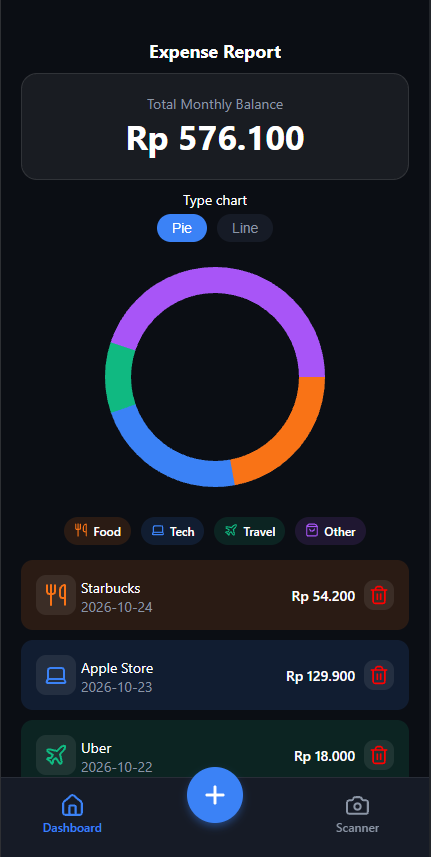
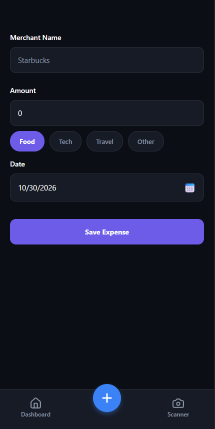
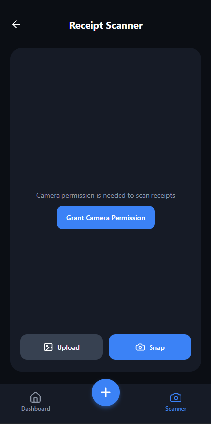

# Offline Expense & Receipt Scanner 📱🧾

A modern, offline-first personal finance and receipt scanning mobile application built with **React Native**, **Expo (SDK 58)**, and **TypeScript**. Designed with a dark-mode fintech UI, custom SVG data visualizations, local device persistence, and automated OCR receipt extraction.

---

## 📲 Download & Try the App (Android APK)

- https://expo.dev/accounts/jansenssu19/projects/offline-first-expense-receipt-scanner/builds/d3fc35c1-5304-4dd8-911d-1eef6012f120

---

## 📸 Screenshots

| Dashboard & Charts | Manual Expense Entry | AI/OCR Receipt Scanner |
| :---: | :---: | :---: |
|  |  |  |

---

## ✨ Key Features

- **📊 Interactive Dashboard & Custom SVG Analytics:**
  - Real-time monthly spending total and category breakdown (`Food`, `Tech`, `Travel`, `Other`).
  - Custom-built **SVG Donut Chart** and **Segmented Bar Chart** (`react-native-svg`) with instant view toggling.
  - One-tap interactive category filtering on the transaction feed.
- **📸 Smart Camera & Gallery Receipt Scanner (OCR):**
  - Integrated live camera viewfinder (`expo-camera`) and photo library picker (`expo-image-picker`).
  - Automated OCR text extraction (`OCR.space Engine 2`) paired with a custom regex receipt parser that detects **Merchant Name**, **Total Amount** (supporting multi-currency formats like IDR, USD, RM, EUR), **Date**, and **Category** keywords.
  - Inline editable OCR confirmation card (`KeyboardAvoidingView`) allowing quick adjustments before saving.
- **➕ Manual Expense Entry:**
  - Accessible via a raised center floating action button (`+`) in the custom bottom tab bar.
  - Native Date Picker integration (`@react-native-community/datetimepicker`) and category pill selector.
- **💾 Offline-First Persistence:**
  - Powered by `@react-native-async-storage/async-storage` and React Context (`ExpenseContext`), ensuring all transactions and scanned receipts persist locally across app restarts without requiring an internet connection.

---

## 🛠️ Tech Stack

| Layer | Technology |
| :--- | :--- |
| **Framework** | [Expo](https://expo.dev/) (SDK 58) & [React Native](https://reactnative.dev/) (0.88) |
| **Navigation** | [Expo Router](https://docs.expo.dev/router/introduction/) (File-based routing & Custom Tabs) |
| **Language** | [TypeScript](https://www.typescriptlang.org/) (Strict Mode) |
| **Charts & Graphics** | `react-native-svg` & `lucide-react-native` |
| **Hardware & Media** | `expo-camera`, `expo-image-picker` |
| **Local Storage** | `@react-native-async-storage/async-storage` |

---

## 📂 Project Structure

```text
src/
├── app/
│   ├── _layout.tsx        # Root ThemeProvider & ExpenseProvider wrapper
│   ├── index.tsx          # Dashboard screen (Balance, Charts, Category Filter, Expense List)
│   ├── add.tsx            # Manual Expense Entry screen with DateTimePicker
│   └── scanner.tsx        # Camera & Gallery Receipt Scanner with OCR & inline editing
├── components/
│   ├── app-tabs.tsx       # Custom 3-tab bottom navigation bar with raised '+' button
│   └── SpendingChart.tsx  # Custom SVG Donut (Pie) & Segmented Line chart component
├── context/
│   └── ExpenseContext.tsx # Global state & AsyncStorage offline persistence
├── types/
│   └── expense.ts         # TypeScript interfaces, category config, and currency types
└── utils/
    ├── formatCurrency.ts  # Intl.NumberFormat currency formatter (IDR, USD, EUR)
    └── parseReceipt.ts    # OCR API client & regex heuristic receipt parser
```

---

## 🚀 Getting Started

### 1. Install Dependencies
```bash
npm install
```

### 2. Start the Expo Development Server
```bash
npx expo start
```

- Press **`a`** to open in an Android Emulator.
- Press **`i`** to open in an iOS Simulator.
- Press **`w`** to open in a Web Browser.
- Or scan the QR code using the **Expo Go** app on your physical device.
